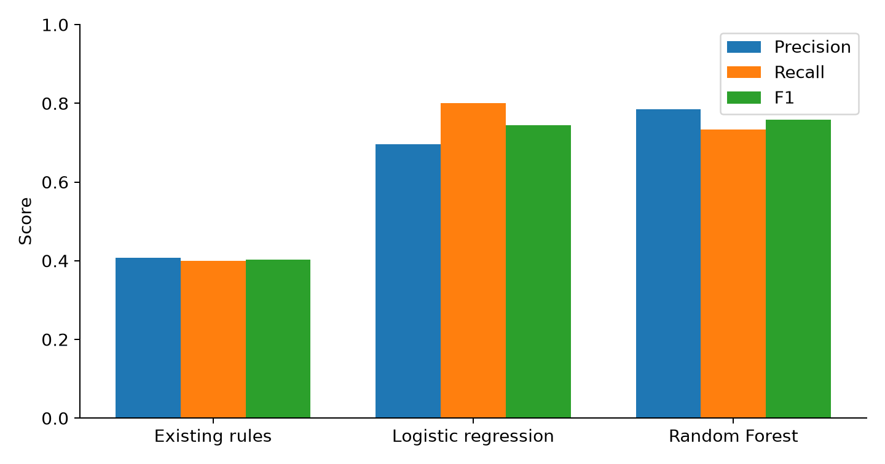

# Aster — Expense Fraud Analysis

**From rules and statistical screening to supervised learning and relationship analysis.**

A two-stage cybersecurity analytics project by **Kyaw Thiha (Kendrick)** for ITCY514, Fraud Analysis and Detection, Mahidol University. It investigates fictional employee travel reimbursements while separating data-quality problems, suspicious patterns and legitimate exceptions.

## Project progression

| Stage | Data | Main methods | Explore |
|---|---|---|---|
| Midterm | 176 synthetic claim rows | Reconciliation, rules, robust scores, peer comparisons and breakpoint screening; optional n8n/Gemini workflow | [Code and setup](midterm/) |
| Final | 4,800 valid synthetic claims | Logistic regression, Random Forest, FP-Growth and graph communities; chronological evaluation | [Notebook and results](final/) |

## Key result

On 800 unseen synthetic claims containing 60 planted fraud cases, Random Forest detected **44 with 12 false alarms**: **78.6% precision, 73.3% recall and 0.759 F1**. The existing rules detected 24 with 35 false alarms. Random Forest was selected on validation results before the test was inspected. Later-period recall fell to 58.3%, showing a limitation of the experiment.

## What this demonstrates

- Preserve invalid records in quarantine and reconcile counts and amounts.
- Build historical features without looking into future transactions.
- Fit preprocessing on training data and select thresholds on validation data.
- Report false alarms, missed cases and precision–recall trade-offs.
- Treat associations and shared merchants as investigation leads requiring context.

Start with the [final analysis](final/README.md) for Python and machine learning, or the [midterm workflow](midterm/README.md) for rules and n8n.

## Scope and attribution

Every person, company, bank account and transaction is synthetic. This is an academic experiment, not evidence of real fraud or production detection performance. The final case extends the midterm story using a separate fictitious ledger and year; the datasets should not be concatenated.

This repository combines the author's two project stages. Peer submissions, peer-review findings and class role-play verdicts are outside the public release. No independent review is claimed. AI assisted implementation and writing; the analytical code computes the results.
