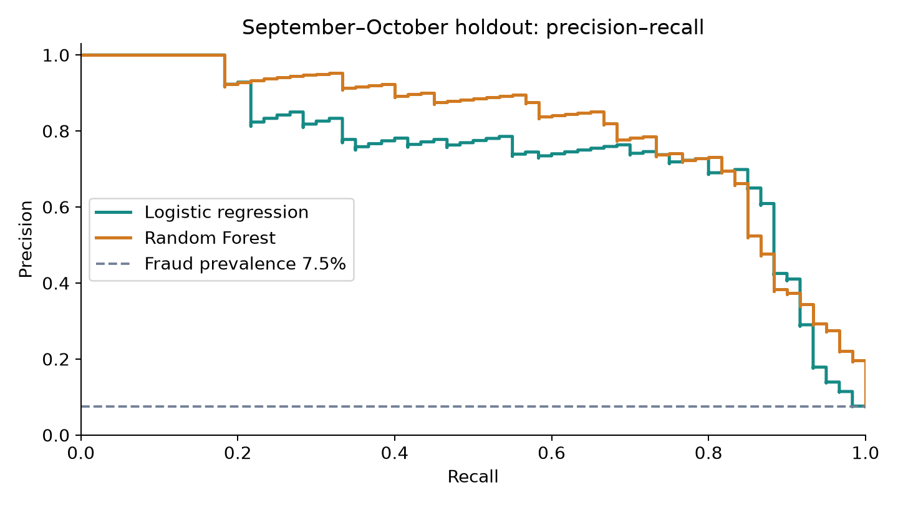
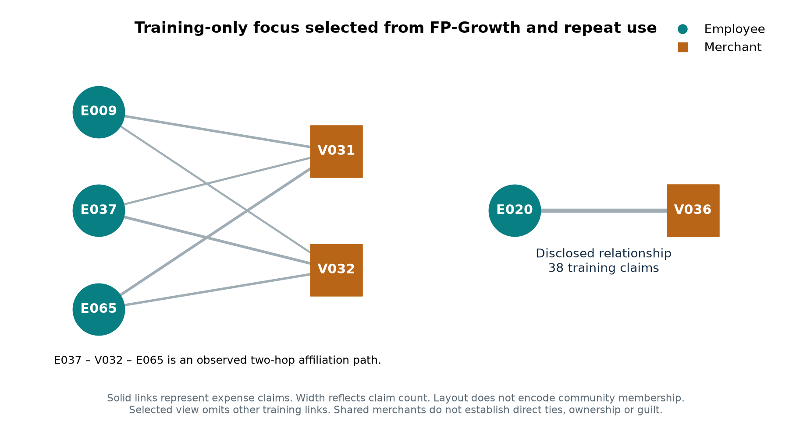

# Final: supervised learning and relationship analysis

The fictional 2025 ledger contains 4,812 raw claims: 4,800 valid and 12 quarantined. Five tables describe employees, merchants, trips, approvals and claims. Evaluation uses planted synthetic labels generated separately from the detection rules.

## Reproduce

Use Python 3.12 and install the pinned dependencies. From this folder:

```sh
python -m venv .venv
source .venv/bin/activate
python -m pip install -r requirements.txt
python tools/project_core.py
```

The command regenerates the synthetic source files and analytical outputs in this folder. Alternatively install JupyterLab and run `Aster_Fraud_Analysis.ipynb` top to bottom; the notebook writes to `notebook_run/`. The notebook outputs were cleared for publishing; saved tables and figures in `reports/` preserve the submitted analytical results. Fitted model binaries are generated locally and excluded from Git.

## Design and results

Train January–June (2,400 claims), choose thresholds and model on July–August (800), test September–October (800), then check November–December (800). Historical features look backward. Labels and entity IDs are excluded from classifier inputs. Transforms fit on training data only.

| Method | Test true positives | False positives | Precision | Recall | F1 |
|---|---:|---:|---:|---:|---:|
| Existing rules | 24 | 35 | 40.7% | 40.0% | 0.403 |
| Logistic regression | 48 | 21 | 69.6% | 80.0% | 0.744 |
| Random Forest | 44 | 12 | 78.6% | 73.3% | 0.759 |

The test contains 60 planted fraud claims. Random Forest was selected by validation F1, with test average precision 0.806. Its later-period recall falls to 58.3% under subtler simulated inflation.



FP-Growth finds five training associations. The training affiliation graph has 147 observed nodes, 1,703 distinct employee–merchant links and nine communities. Relationships retain source-claim provenance; they do not prove collusion. No graph feature enters the supervised classifiers.



## Interpretation

This is one synthetic generator with one seed and overlapping entities across periods. Scores are uncalibrated, review amounts are not confirmed losses, and real-world generalization has not been established. All results here come from the author's analytical experiment. Peer data, peer reports and the class role-play verdict are excluded; no independent peer review is claimed.
